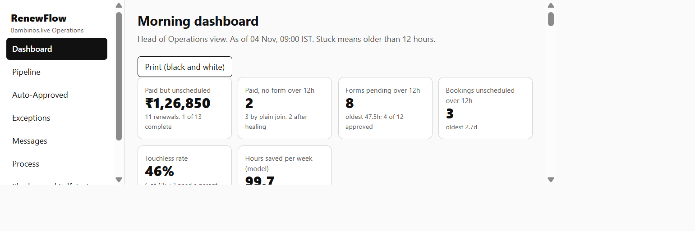
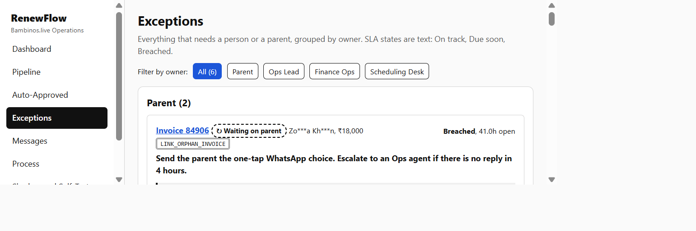
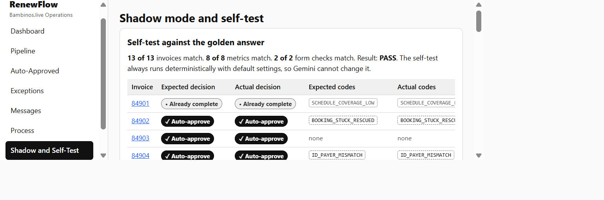

# RenewFlow

## What it is

RenewFlow is a reconciliation and auto-approval engine for the Bambinos.live
student-renewal to class-scheduling pipeline. It loads the five sample tables, links
records, applies deterministic checks, assigns decisions and owners, and drafts
operational messages.

## The problem

A renewal moves through invoices, teacher forms, booking requests, and schedule rows.
On the sample data, only 1 of 13 renewals is fully scheduled and Rs 126,850 is paid
but unscheduled. The sample includes orphaned invoices, an invoice-ID typo, duplicate
forms, a failed payment with a form, a partial payment, an unapproved discount, a
false batch-full result, and an unavailable batch change. The engine makes these
failures visible with reason codes, owners, timers, and proposed actions.

## Quick start

```bash
python -m venv .venv
# Windows: .venv\Scripts\activate
# macOS/Linux: source .venv/bin/activate
pip install -r requirements.txt
uvicorn app.main:app --reload
```

Open http://localhost:8000, choose **Data and Run**, and load the sample data.
`python cli.py --data data/sample --out results` writes the reconciliation output.
Set `RENEWFLOW_AUTOLOAD=1` to load the sample data at startup.

Gemini is optional. Copy `.env.example` to `.env` and set a key only when language
assistance is wanted. Without a key, keyword rules and templates are used.

## Result on the sample data

The committed output and self-test cover 13 of 13 invoices, 8 of 8 metrics, and 2 of
2 form checks. The run produces:

- 6 `AUTO_APPROVE` cases: 84902, 84903, 84904, 84905, 84908, and 84913
- 2 `FAST_TRACK_PENDING_PARENT` cases: 84906 and 84910
- 3 `FLAGGED` cases: 84907, 84909, and 84912
- 1 `BLOCKED` case: 84911
- 1 `ALREADY_COMPLETE` case: 84901
- 144 proposed schedule rows and a 46% touchless rate

The screenshots show the main review surfaces:






## Pages

Dashboard, Pipeline, Auto-Approved, Exceptions, Messages, Process, Shadow and
Self-Test, and Data and Run.

## Tests

```bash
pytest
```

The suite contains 44 tests covering normalization, masked matching, linking and
healing, the golden self-test, decisions and proposed rows, payment policy,
parent-reply flow, optional Gemini behavior, loader errors, API endpoints, and scale.

## Layout

```text
app/             FastAPI app, loader, engine, in-memory store, and optional Gemini layer
static/          HTML, CSS, JavaScript pages, and vendored Chart.js
data/sample/     Five official CSVs and expected_results.json
results/         Committed reconciliation output
tests/           pytest suite
cli.py           Command-line runner
docs/            Architecture, case analysis, SOP, rollout, SQL, n8n, and diagrams
prompts/         Runtime and development prompts
```

## Design notes and assumptions

- Same-batch renewals are seat-neutral because the student already holds the seat.
- A typo is healed only with strong evidence; otherwise the form remains an orphan.
- Payer differences do not block when the student and user IDs match.
- Partial payments are held by default; discounts require an approver.
- Proposed rows use a lookup key because the live schedule table is not in the sample.
- State is in memory and approvals, replies, and audit entries reset on restart.
- Sends are simulated; no message leaves the application.
- Hours-saved figures are labelled assumptions, not production measurements.
- SQL and n8n artifacts are documentation exports and were not run on live systems.
- Gemini is optional and falls back to templates and keyword rules.

## How this was built

Developed with AI coding assistance; the engine rules, data analysis, and decisions
were reviewed and owned by me. All application behavior is verified by the pytest
suite.
